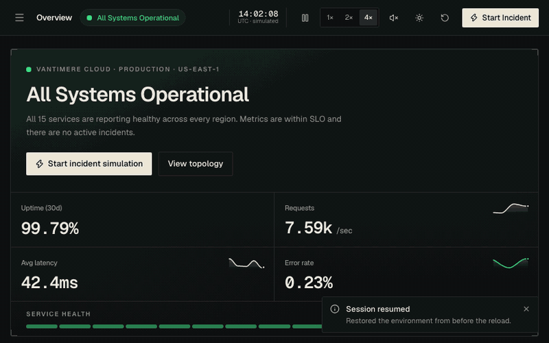

# Hi, I'm Chad

I'm a Network IT Specialist at Rockbot in Austin, TX. I own Tier 2/3 escalations across customer networks, SSO, APIs and connected devices, and I'm the main link between Support and Engineering.

**Portfolio:** [chad-kraus-portfolio.vercel.app](https://chad-kraus-portfolio.vercel.app/?from=github) · **LinkedIn:** [in/chadwick-kraus](https://www.linkedin.com/in/chadwick-kraus/)

TechOps Command Center: a simulated DNS outage, from the first alert to recovery. [Try it live](https://techops-command-center.vercel.app/).

## How I work

- I reproduce it before I escalate it, and I work from the logs and the actual requests and responses.
- I write down what I found, what I tried, and what happens next, so nobody has to start over.
- When the same issue keeps coming back, I push for the fix in Bug Triage instead of answering it again.
- If a tool would save the team time, I build it. That's how the Chrome extension our frontline agents use got started.

Outside work, I'm usually tinkering with my home lab or building something new with Claude Code.

## Featured projects

| Project | What it is | Try it |
| --- | --- | --- |
| [TechOps Command Center](https://github.com/chadkraus87/techops-command-center) | Incident-response simulator. Trigger an outage, work it through logs, metrics, topology and network tools, then diagnose and fix it. | [Live demo](https://techops-command-center.vercel.app/) |
| [HomeLab Commander](https://github.com/chadkraus87/home-lab-commander) | Local-first command center for discovering, monitoring and documenting a homelab, with a safe hosted demo. | [Live demo](https://home-lab-commander.vercel.app) |
| [Stack City](https://github.com/chadkraus87/stack-city) | Browser strategy game for learning systems architecture by building and running a city of services. | [Play](https://stack-city-eight.vercel.app) |
| [Lavi](https://github.com/chadkraus87/lavi) | A desktop robot for Claude Code sessions: next-step advice, a pre-commit secret check, and phone pings. | macOS app |

## Writing

- [Postmortem: DNS resolution failure](https://github.com/chadkraus87/techops-command-center/blob/main/docs/postmortem-dns-resolution-failure.md). A write-up of a simulated outage in TechOps, the way I'd write one at work: impact, timeline, what I ruled out, root cause, fix and prevention.

## What I work with

Networking (TCP/IP, DNS, DHCP, VPN, VLANs) · SSO, SAML, Okta, Entra ID · REST APIs, webhooks, Postman · Zendesk, Jira · TypeScript, React, Next.js, Python · Claude Code, MCP servers, n8n · Vitest, Playwright
